# Anga Air

**Fly the East African skies.** A complete airline booking and operations platform for a
fictional regional carrier hubbed in Nairobi. "Anga" is Swahili for "sky".

[](https://github.com/katualabs/Flight_Ticketing_System/actions/workflows/ci.yml)


> **Demo project.** Anga Air is fictional. No real bookings or payments take place, and no real
> airline is imitated.

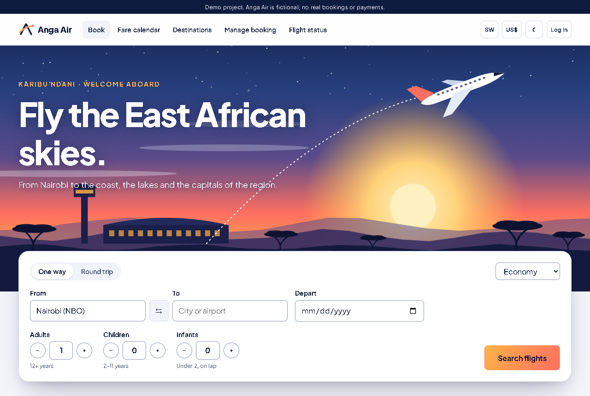

## Highlights

- **Real inventory control.** Seats and fare buckets are taken in one transaction using guarded
  updates, and a test races two connections for the last seat to prove it can't oversell.
- **Real pricing rules.** Fare families, weekend surge, demand pricing as cabins fill, promo codes,
  change fees and refunds, all as pure functions.
- **The full journey.** Search, fare calendar, seat maps, simulated M-Pesa, QR e-tickets, changes,
  cancellations, online check-in and boarding passes.
- **An operations console.** Role-based dashboards with hand-drawn SVG charts, flight control,
  manifests, bookings, promos, users, an outbox viewer and an audit log.
- **Security built in.** Strict CSP with no `unsafe-inline`, CSRF on every write, parameterised SQL,
  login lockout and booking privacy, with tests that scan the source for regressions.
- **No framework bloat.** Hand-written SQL, a custom CSS design system and vanilla JS. Every page
  works without JavaScript, and all artwork is generated by a script.

## A look around

| | |
| --- | --- |
| 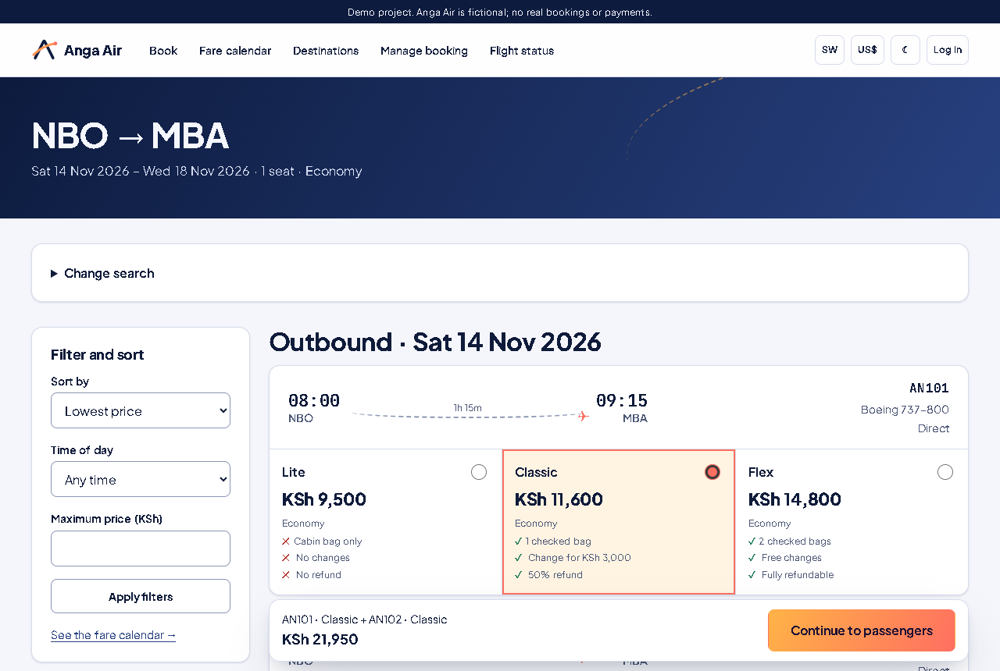 | 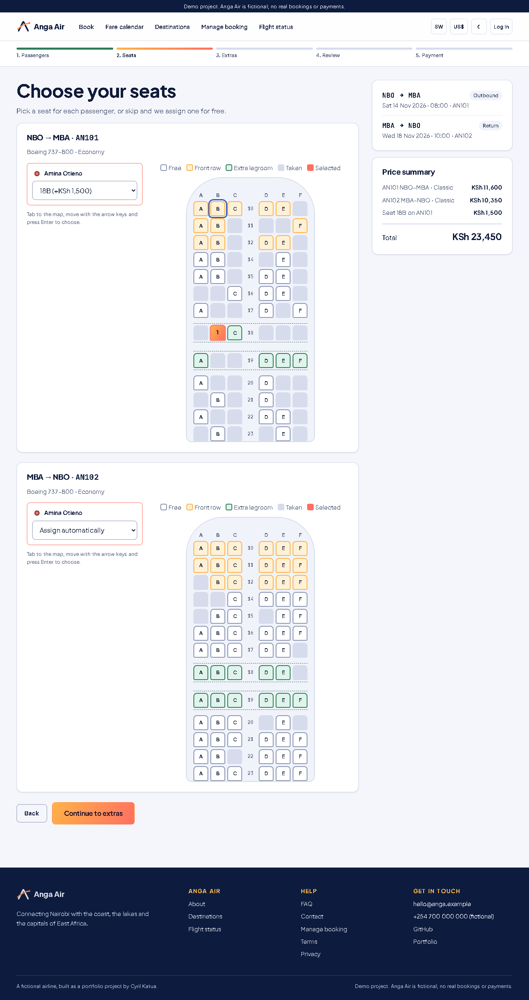 |
| **Search results.** What each fare family includes, at a glance. | **Seat map.** Drawn from the aircraft layout, and keyboard accessible. |
| 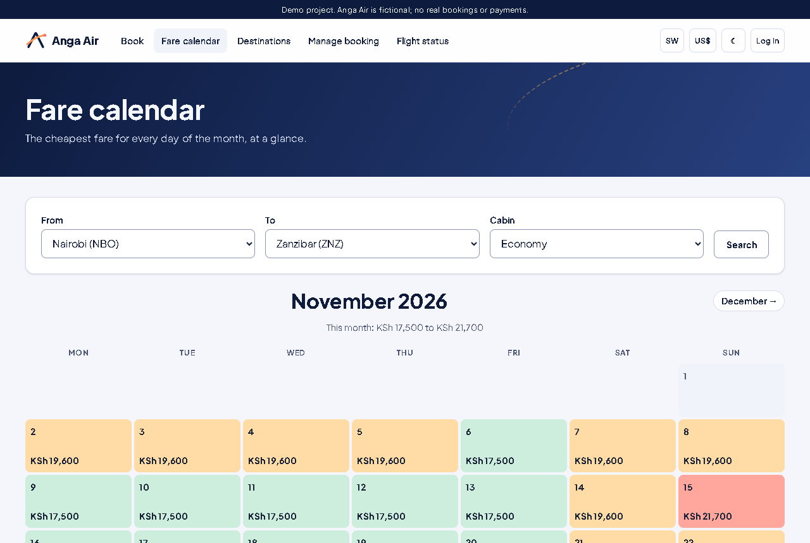 | 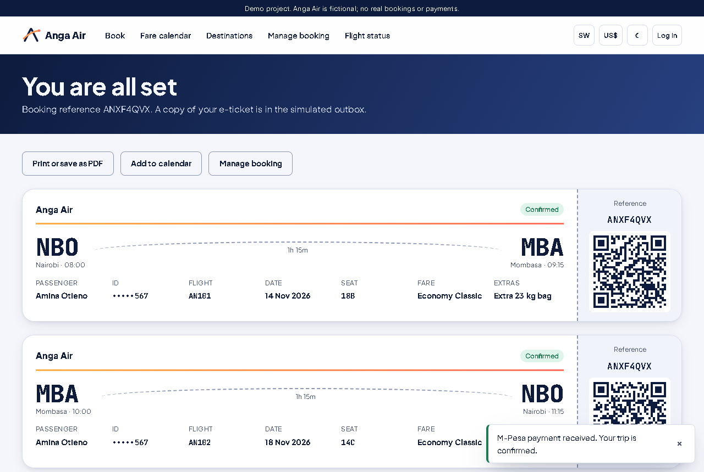 |
| **Fare calendar.** The cheapest fare for every day of the month. | **E-ticket.** Printable, with a QR code and an `.ics` calendar download. |
| 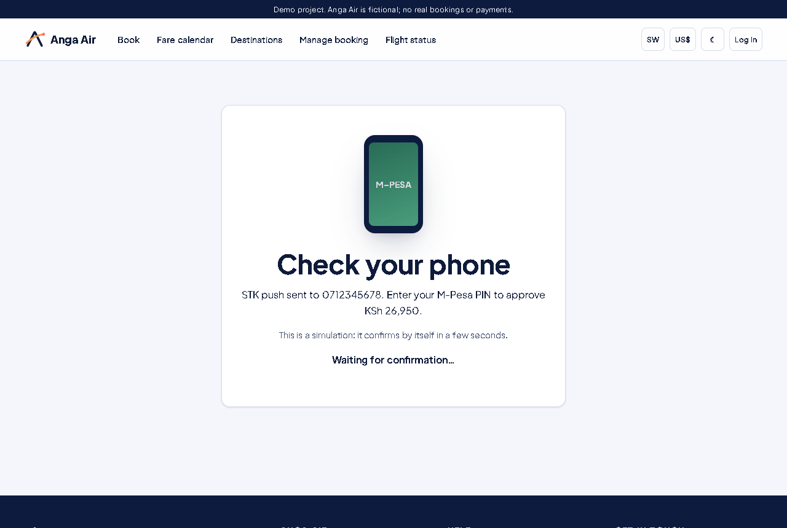 | 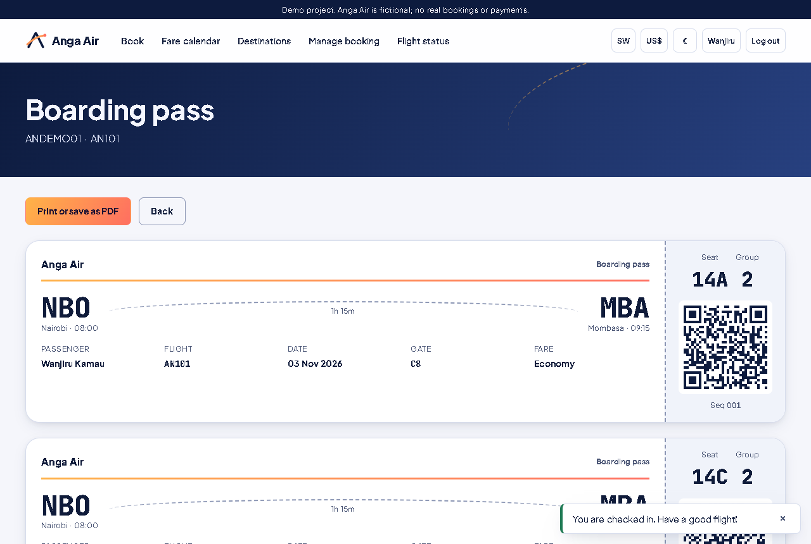 |
| **M-Pesa.** A simulated STK push, with a polling status screen. | **Check-in.** Opens 48 hours out; passes show group and sequence. |
| 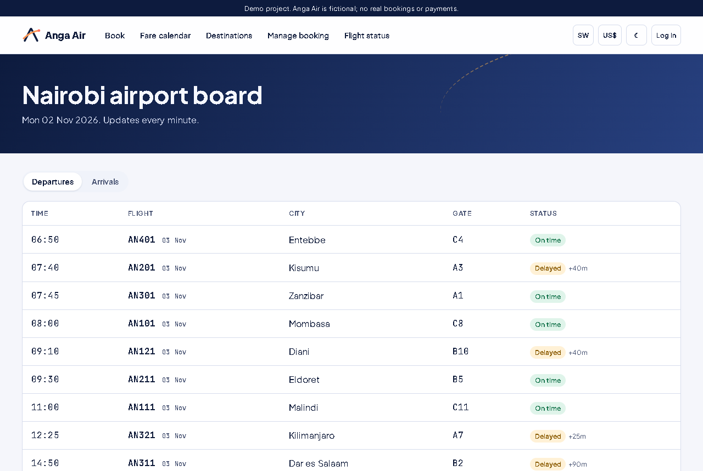 | 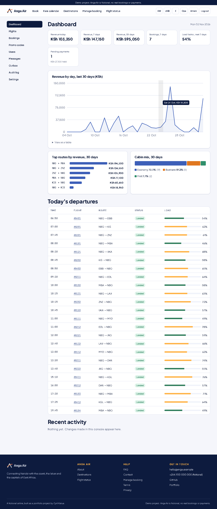 |
| **Flight board.** Refreshes every minute from the JSON API. | **Operations.** Revenue, load factor and today's departures. |
| 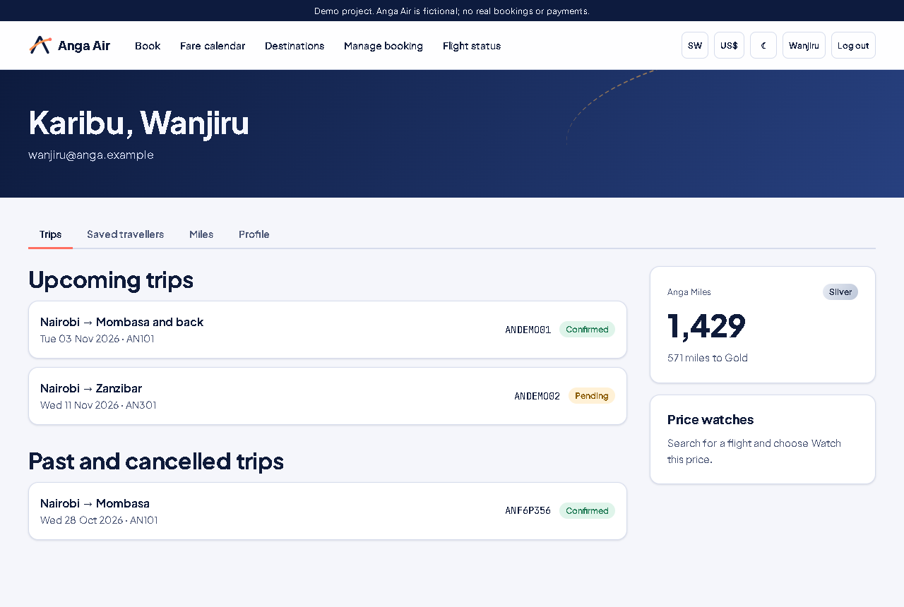 | 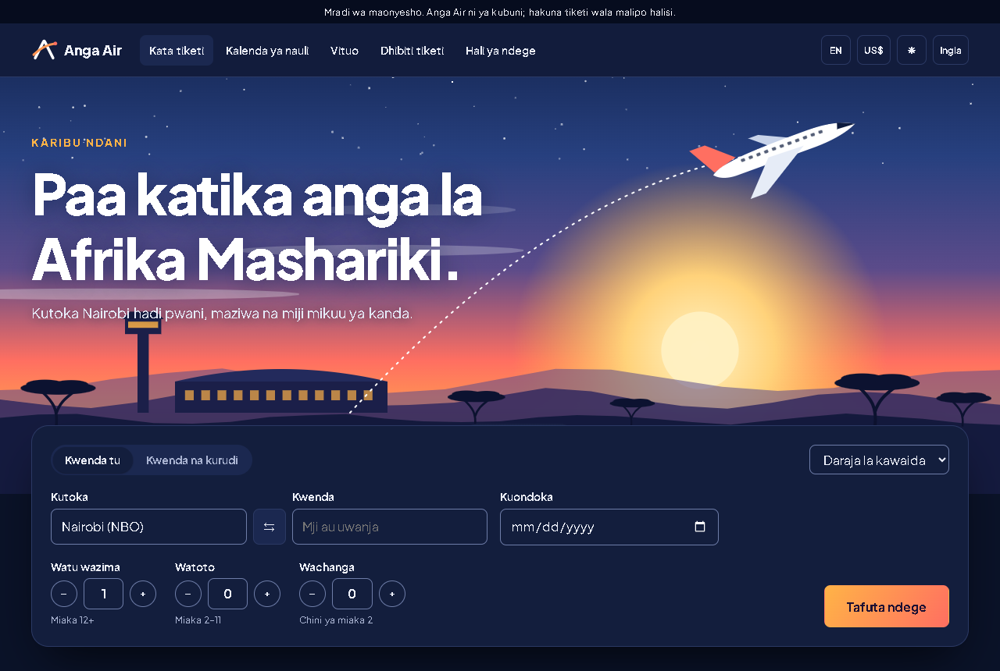 |
| **Accounts.** Trips, Anga Miles and price-drop watches. | **Dark mode and Swahili.** Plus a KSh/USD display toggle. |

## Tech stack

| Area | Choice | Why |
| --- | --- | --- |
| Language | Python 3.11+ | Type hints throughout services and repositories |
| Web | Flask 3, Jinja2 | App factory and Blueprints, with autoescaped templates |
| Database | SQLite, standard `sqlite3` | No ORM: hand-written, parameterised SQL |
| Front end | HTML5, custom CSS, vanilla ES modules | No framework and no build step |
| QR codes | `segno` | Pure Python, with no system dependencies |
| Production | `gunicorn`, Docker | Non-root container with a data volume |
| Quality | `pytest`, `pytest-cov`, `ruff`, GitHub Actions | Tested on Python 3.11 and 3.12 |

## Architecture

Requests flow one way through strict layers, and tests fail if a module crosses a boundary.

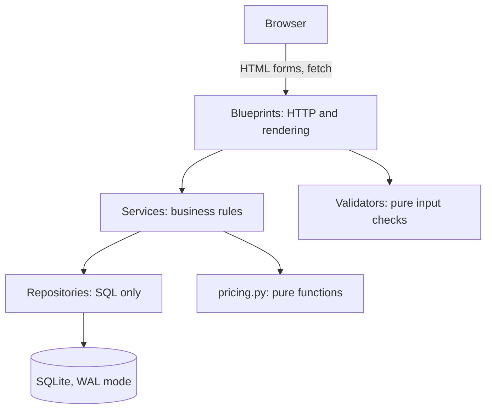

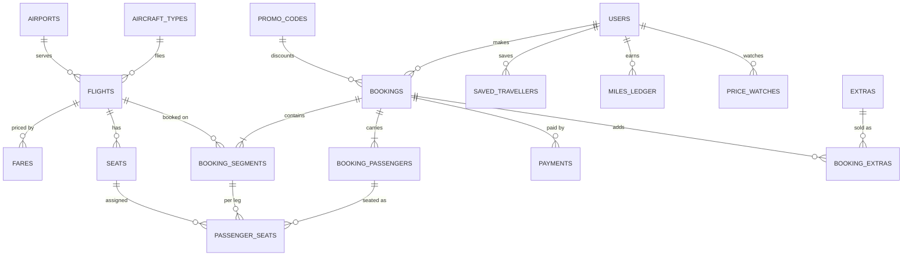

### Key design decisions

- **No ORM, on purpose.** The interesting queries read clearly as SQL, and a guarded inventory
  update is exactly one statement.
- **Transactions for inventory.** `BEGIN IMMEDIATE` plus conditional `UPDATE`s means correctness
  doesn't depend on anything a request read earlier.
- **Fare families as buckets.** Lite, Classic and Flex partition each cabin, and always add up to
  the seats physically on board.
- **Demand pricing at read time.** Prices rise as a cabin passes 60% and 85% full. Only base fares
  are stored, so a shown price can't drift from inventory, and customers see any change before
  they are charged.
- **Server-side wizard state.** Passenger ID numbers stay on the server, not in a cookie.

There is more detail, including known limitations, in [docs/architecture.md](docs/architecture.md).

## Quick start (VS Code on Windows)

You need Python 3.11 or newer.

1. Create a virtual environment:
   ```powershell
   python -m venv .venv
   ```
2. Activate it:
   ```powershell
   .venv\Scripts\Activate.ps1
   ```
   If PowerShell blocks the script, run this once and try again:
   ```powershell
   Set-ExecutionPolicy -Scope CurrentUser RemoteSigned
   ```
3. Install the dependencies:
   ```powershell
   pip install -r requirements-dev.txt
   ```
4. Create your settings file:
   ```powershell
   copy .env.example .env
   ```
5. Load the demo data:
   ```powershell
   flask --app anga seed --reset
   ```
6. Start the server, then open http://127.0.0.1:5000:
   ```powershell
   python run.py
   ```

If something else is already using port 5000, Windows may let both servers start and you could
see the other app. Stop it, or set `PORT` in `.env` to use another port.

On Linux or macOS, activate with `source .venv/bin/activate` and copy with `cp`. The demo data
also seeds itself on first run if you skip step 5.

VS Code picks up the included run configurations, **Anga Air: Flask** and **Anga Air: pytest**.
There is also an optional desktop control panel: `python launcher.py`.

## Docker

```bash
docker compose up --build
```

Then open http://localhost:8000. Data and the generated secret key live in a named volume. The
compose file turns off Secure cookies so that login works over plain `http://localhost`; remove
`ANGA_COOKIE_SECURE` when serving over HTTPS.

## Demo accounts and bookings

Everything here is fictional. Passwords can be overridden with environment variables (see
[.env.example](.env.example)).

| Role | Email | Password |
| --- | --- | --- |
| Admin | `admin@anga.example` | `AngaAdmin#2026` |
| Agent | `agent@anga.example` | `AngaAgent#2026` |
| Customer | `wanjiru@anga.example` | `AngaFly#2026` |

| Reference | Email | State |
| --- | --- | --- |
| `ANDEMO01` | `wanjiru@anga.example` | Confirmed, with check-in open |
| `ANDEMO02` | `wanjiru@anga.example` | Pending payment for 24 hours after seeding |

The schedule is generated relative to today. To refresh the demo bookings, run
`flask --app anga seed --reset`.

| To try | Use |
| --- | --- |
| M-Pesa success | Any Kenyan mobile number, such as `0712345678` |
| M-Pesa failure | A number ending in `000`, such as `0712345000` |
| Demo card | `4242 4242 4242 4242`, any future expiry, any 3-digit code |
| Promo codes | `KARIBU10` (10% off, minimum KSh 10,000), `COAST2026` (KSh 1,500 off coastal routes), `EXPIRED5` (expired, to see the validation) |
| Nearly full flight | `AN201` from Nairobi to Kisumu, three days from today |

## A 5-minute tour

1. **Search.** On the home page, hover over the route map, then search Nairobi to Mombasa as a round
   trip. Open the fare calendar from the results to compare dates.
2. **Book.** Choose a Classic fare, click a seat and watch the price update. Add a bag, apply
   `COAST2026`, and pay by M-Pesa with `0712345678`.
3. **Your ticket.** See the QR e-ticket, try printing it, and download the calendar file.
4. **Check in.** Log in as Wanjiru, open `ANDEMO01`, check in, and view the boarding pass.
5. **Operate.** Log in as the admin. Delay a flight and watch it change on the
   [public board](http://127.0.0.1:5000/status/board/NBO). Read the emails in the outbox, then see
   your actions in the audit log.
6. **Try the rest.** Log in as the agent and notice what's missing from the menu. Then switch the
   theme, language and currency in the header.

## API

A read-only JSON API serves airports, flights, status, the fare calendar and airport boards, with
consistent envelopes, input validation and per-IP rate limiting.

```bash
curl "http://127.0.0.1:5000/api/v1/flights/AN101/status"
```

See the [API reference](docs/api.md).

## Testing

```bash
pytest --cov
ruff check .
```

The suite runs against a temporary database with a frozen clock, and covers search, pricing, the
booking wizard, concurrency, payments, changes, check-in, accounts, admin permissions, the API and
security. The latest results, including coverage, are in
[docs/test_results.txt](docs/test_results.txt).

## Security

- **Injection:** parameterised SQL only, and server-side validation of every input.
- **XSS:** Jinja2 autoescaping, a strict CSP with no inline scripts or styles, and no `|safe` on any
  template.
- **CSRF:** a session token on every state-changing request, compared in constant time.
- **Accounts:** salted password hashes, strong-password rules, a fresh session on login, logout by
  POST, and a temporary lockout after failed attempts.
- **Access:** role checks on every console route, with tests proving agents can't reach admin pages.
- **Privacy:** a booking is visible only to its owner, staff, or a session that proved reference and
  email. Failed lookups all look the same, and ID numbers are masked.
- **Payments:** simulated. Only the last four digits of the test card are kept.
- **Headers and cookies:** `X-Content-Type-Options`, `X-Frame-Options`, `Referrer-Policy`,
  `Permissions-Policy`, HSTS in production, `no-store` on private pages, and HttpOnly, SameSite and
  Secure cookies.
- **Other:** safe redirects (local paths only), request size limits, per-IP rate limits on the API
  and booking lookups, and CSV exports protected against formula injection.

## Roadmap

- Real M-Pesa integration through the Daraja API, with webhooks replacing the polling simulation
- PostgreSQL, for concurrent writers
- Multi-city trips and connecting flights
- A React Native mobile app built on an expanded API
- Real email delivery and calendar invitations

## Author

**Cyril Katua**: [GitHub](https://github.com/katualabs) ·
[Portfolio](https://katualabs.github.io/my-personal-portfolio/)

## Licence

[MIT](LICENSE) © Cyril Katua. Plus Jakarta Sans and JetBrains Mono are self-hosted under the SIL
Open Font License.
