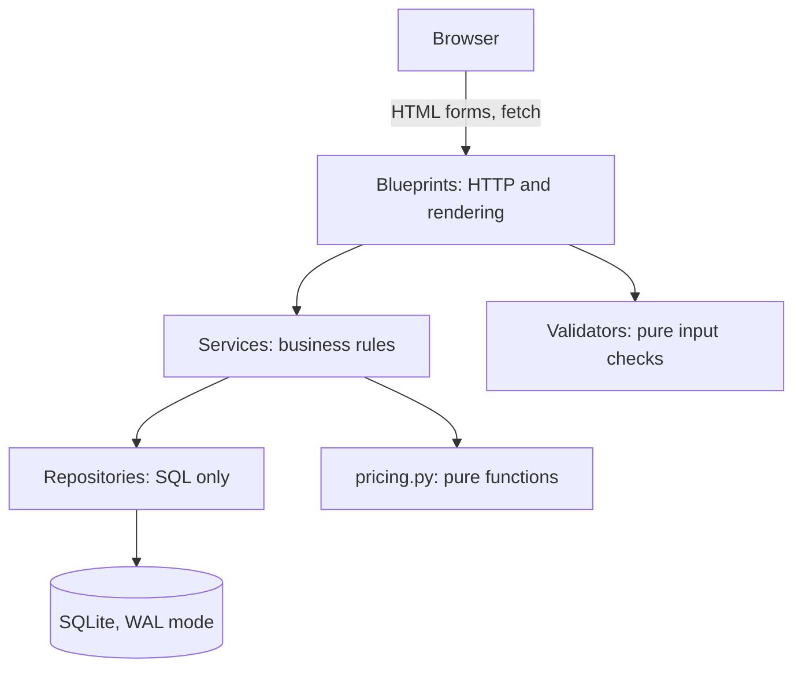

# Architecture

Anga Air is a server-rendered Flask application over SQLite. This document explains how it is
organised and why, for anyone reading or extending the code.

## Layers

Requests move in one direction, and tests in `tests/test_security.py` fail if a module reaches
across a boundary.



| Layer | May do | May not do |
| --- | --- | --- |
| `blueprints/` | Parse requests, call services, render responses | Import `sqlite3` or repositories |
| `services/` | Enforce rules, open transactions | Import blueprints or read the request |
| `repositories/` | Run parameterised SQL | Import Flask or services |
| `services/pricing.py` | Pure arithmetic | Import anything from the app at all |

## Key decisions

### No ORM

SQL is written by hand in the repository layer. The interesting queries here (cabin load through
correlated subqueries, reporting aggregates) read clearly as SQL, and the guarded updates below
are exactly one statement each. Tests check that f-strings in SQL only splice constants and
clause lists, with all values bound as parameters.

### Inventory cannot be oversold

Selling seats happens in one `BEGIN IMMEDIATE` transaction using conditional updates:

```sql
UPDATE fares SET available_seats = available_seats - ?
WHERE id = ? AND available_seats >= ?;
```

The check lives inside the `UPDATE`, so correctness doesn't depend on anything a request read
earlier. If any step fails (a sold-out bucket, a taken seat, an exhausted promo), the whole
transaction rolls back. `test_concurrent_last_seat_race` proves this with two real connections.

### Fare buckets partition the cabin

Each cabin's seats are divided between Lite, Classic and Flex, and the buckets always add up to
the seats physically present. Demand is measured at cabin level, so filling Lite raises Flex too.

### Prices are computed at read time

`fares.price` stores only the base fare. Weekend and demand adjustments are applied whenever a
fare is read, so the displayed price can never drift from current inventory. Because a price can
move while someone is checking out, the payment form carries the total they were shown, and the
booking is refused with an explanation if it no longer matches.

### Wizard state is server-side

A signed session cookie is too small for nine passengers, and passenger ID numbers shouldn't
travel to the browser. The cookie holds a random token that points to a `booking_drafts` row.

### Simulated time and payments

All time goes through `clock.py`, which tests freeze and the seed moves backwards. Past demo
bookings therefore go through the real services, and their payments, seats, miles and emails
agree by construction.

M-Pesa is simulated with a settle-at timestamp resolved when the status endpoint is polled. The
settlement update is guarded, so polling from two tabs still confirms and awards miles once.

### No background workers

Hold expiry and flight status updates run from a `before_request` hook at most once a minute, and
price watches are checked when the dashboard opens. Each also has a CLI command for cron. This
suits a SQLite-sized deployment, at the cost of nothing happening while the site has no traffic.

### A strict Content Security Policy

There is no `unsafe-inline`, for scripts or styles. Fonts are self-hosted, and colour bars use
`<meter>` elements and SVG attributes rather than style attributes. Tests scan every template for
inline scripts, `style=` attributes and `|safe`. Emails do need inline styles, so previews load
in a sandboxed frame with a separate policy that allows no scripts.

### Progressive enhancement

Every journey works without JavaScript. The autocomplete upgrades a `<select>`, the seat map
drives per-passenger `<select>` elements, and the M-Pesa wait page falls back to a meta refresh.
The browser never calculates money: the live summary posts the form and swaps in server-rendered
HTML.

## Data model

The full schema is in [`anga/schema.sql`](../anga/schema.sql), with later changes as numbered
files in [`anga/migrations/`](../anga/migrations/).

One deliberate design point: check-in state lives on `passenger_seats` (one row per passenger per
segment) rather than on the passenger, because each leg of a round trip is checked in separately.
Infants have a row with a `NULL` seat.

Refunds are `payments` rows with `kind = 'refund'`, so payment history is append-only and net
revenue is charges minus refunds. Bookings are never deleted, only marked `Cancelled`.

## Known limitations

- **Rate limits are per process.** Each gunicorn worker keeps its own token buckets. Login
  lockouts are stored in the database and hold across workers.
- **A lockout can be triggered by anyone** who knows an email address. Real systems add per-IP
  throttling and CAPTCHA.
- **Date formats are English** even in the Swahili interface, and staff console text is English.
- **SQLite allows one writer at a time.** Fine for a demo, and the reason PostgreSQL is on the
  roadmap.
